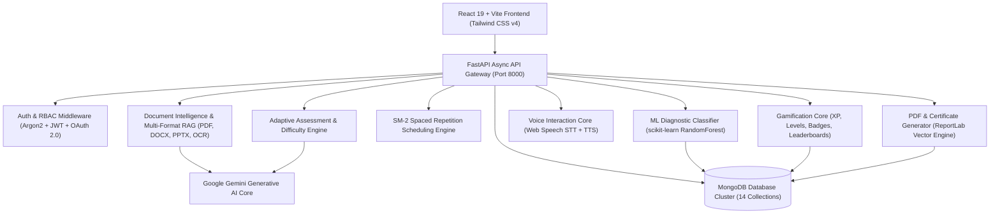
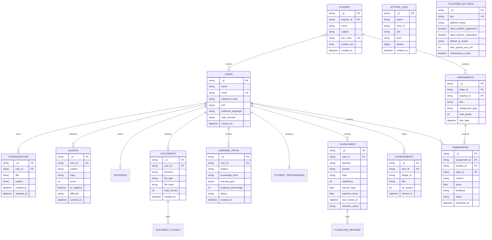

# Mentora AI — AI-Powered Personalized Learning & Adaptive Educational Platform

**Mentora AI** is an industry-grade, production-quality AI/ML Major Project designed as an end-to-end personalized learning platform. Powered by Google Gemini Generative AI, scikit-learn machine learning classifiers, Retrieval-Augmented Generation (RAG), and the SuperMemo SM-2 spaced repetition algorithm, Mentora AI transforms passive study into active, adaptive, and verifiable conceptual mastery.

---

## 1. System Architecture



---

## 2. Database Entity-Relationship (ER) Architecture

Mentora AI maintains a normalized MongoDB data architecture across 14 collections with strict compound indexing, referential integrity, and multi-tenant isolation:



---

## 3. Technology Stack

| Layer | Component | Version | Description |
|---|---|---|---|
| **Frontend** | React | 19.0.0 | Component architecture & modern Hooks |
| | Vite | 8.3.2 | Lightning-fast ESM build tool |
| | Tailwind CSS | 4.0.0 | Modern utility-first styling engine |
| | React Router | 7.2.0 | Declarative client-side routing & guards |
| **Backend** | Python | 3.10+ / 3.14 | Core server runtime environment |
| | FastAPI | 0.143.3 | High-performance asynchronous REST API framework |
| | Uvicorn | 0.54.0 | Asynchronous Server Gateway Interface (ASGI) |
| | Pydantic | 2.14.1 | Strict server-side schema validation |
| | PyJWT | 2.15.1 | RFC 7519 standard signed Bearer authentication |
| | pwdlib (Argon2) | 0.3.1 | Password hashing resistant to GPU/ASIC attacks |
| **AI / Machine Learning** | Google GenAI SDK | 2.33.0 | Google Gemini 1.5/2.0 API interaction core |
| | scikit-learn | 1.9.1 | `RandomForestClassifier` student mastery modeling |
| | NumPy / SciPy | 2.5.4 | Mathematical feature vector matrix operations |
| **Document Intelligence** | pypdf | 6.21.4 | PDF page extraction and text streaming |
| | python-docx | 1.2.0 | Microsoft Word (.docx) document parser |
| | python-pptx | 1.0.2 | Microsoft PowerPoint (.pptx) slide & notes parser |
| | pytesseract & Pillow | 0.3.13 / 13.0 | Tesseract OCR engine for scanned image PDFs |
| **PDF & Certificates** | ReportLab | 4.4.1 | Vector graphics PDF report & certificate generator |
| **Database** | MongoDB | 8.0 / 7.0 | High-performance document database cluster |

---

## 4. Key Functional Modules

### Module 1: Authentication & Role-Based Access Control (RBAC)
- Multi-tier role permissions: `student`, `teacher`, and `admin`.
- Argon2 password hashing using `pwdlib.PasswordHash.recommended()`.
- JWT token expiration (120 minutes) with auto-revocation and secure local storage handoff.
- Google OAuth 2.0 integration with state cryptographic token verification.
- Backend enforcement via `require_roles(*allowed_roles)` prevents privilege escalation.

### Module 2: Personalized AI Learning Path
- Structured curriculum generator: Subject, Knowledge Level (Beginner/Intermediate/Advanced), Learning Goal, Daily Study Time, Target Completion Date.
- AI-synthesized daily plans, subtopics, lessons, practice drills, and revision checkpoints.
- Interactive timeline interface with lesson completion toggling and progress percentage recalculation.
- Adaptive path adjustment: student performance dynamically modifies future pacing and daily goals.

### Module 3: AI Weakness Detection & ML Student Profiling
- Dual-layer evaluation engine:
  1. **Rule-Based Baseline**: Computes topic accuracy matrices and classifies mastery into `Mastered` ($\ge 80\%$), `Proficient` ($60-79\%$), and `Needs Remediation` ($< 60\%$).
  2. **Machine Learning Classifier**: Trains a `RandomForestClassifier` (100 estimators, stratified splitting, zero data leakage) on genuine student assessment features (accuracy, response times, attempt counts, consistency scores).
- Topic diagnostic API (`GET /performance/topics/{topic}/diagnostic`) offering focused knowledge gap remediation.

### Module 4: Adaptive Quiz Engine
- Dynamic difficulty scaling algorithm:
  - Correct answers increase difficulty tier (`Beginner` $\rightarrow$ `Intermediate` $\rightarrow$ `Advanced`).
  - Incorrect answers decrease difficulty and flag prerequisite knowledge gaps.
- Difficulty-weighted scoring formula:
  $$\text{Score} = \sum (\text{Base Points} \times \text{Difficulty Multiplier})$$
- Zero frontend score trust: all answer verification and scoring is performed on the server.

### Module 5: Spaced Repetition Flashcards (SuperMemo SM-2)
- Mathematical SM-2 interval algorithm:
  $$EF' = EF + (0.1 - (5 - q) \times (0.08 + (5 - q) \times 0.02))$$
- 4 review response options: `Again` ($q=1$), `Hard` ($q=2$), `Good` ($q=4$), `Easy` ($q=5$).
- Multi-source card generator: synthesizes flashcards from uploaded documents, AI tutor chat histories, and study paths.
- 3D CSS flip-card interface with review queues (`Due Today`, `Upcoming`, `Overdue`).

### Module 6: Advanced Learning Analytics Dashboard
- 30-day activity heatmaps and subject radar performance breakdowns.
- Continuous learning streak counter with timestamp normalization (`_as_utc`).
- Prescriptive AI recommendations detailing what to study next, which topic to revise, and target daily goals.

### Module 7: Document Intelligence & RAG Expansion
- Multi-format ingestion: PDF, TXT, Markdown, DOCX (Word), and PPTX (PowerPoint slides + speaker notes).
- Tesseract OCR fallback for scanned PDF documents.
- SHA-256 fingerprint deduplication prevents redundant vector processing with optional `force=true` override.
- Unit-level page/slide references (`Slide 3`, `Page 12`) in citations.
- Interactive Document Preview modal and document-level RBAC isolation.

### Module 8: Voice-Based AI Tutor
- Web Speech API Speech-to-Text (STT) with continuous interim transcription and audio waveform animations.
- SpeechSynthesis Text-to-Speech (TTS) with regex-based code block and markdown sanitization.
- Multilingual BCP-47 locale mapping across 10 global languages (English, Hindi, Spanish, French, German, Mandarin, Japanese, Arabic, Russian, Portuguese).
- Telemetry tracking: voice queries update `voice_interactions` in student progress.

### Module 9: Teacher Portal & Classroom Management
- Faculty dashboard displaying class counts, student rosters, coursework, and pending submissions.
- Classroom creation with auto-generated unique 6-character alphanumeric join codes (`join_code`).
- Roster management: add/remove students by email or via student self-enrollment.
- Coursework publishing (Homework, Quizzes, Reading, Projects) with deadline and point constraints.
- Grading Console: score assignments, provide constructive feedback, and track completion rates.
- Class-wide diagnostic analytics: aggregate topic mastery scores and highlight at-risk students ($< 60\%$ average).

### Module 10: Admin Portal & Platform Governance
- Multi-tenant directory search, role filtering, and user pagination.
- Role privilege promotion/demotion with self-lockout prevention (admin cannot demote self or remove the sole administrator).
- Real-time database telemetry: MongoDB ping latency (ms) and collection item counters.
- Gemini AI status monitor: active model ID and API key verification state.
- Immutable security audit stream (`system_logs` collection).
- Global platform configuration (platform name, registration toggles, upload size limits, maintenance mode).

### Module 11: Gamification Engine
- Non-manipulable XP engine: XP is awarded server-side for real student actions (quizzes, SM-2 reviews, completed lessons, coursework submissions).
- Deterministic leveling formula:
  $$\text{Level} = \left\lfloor\sqrt{\frac{\text{XP}}{50}}\right\rfloor + 1$$
- 10-badge achievement catalog (`Quiz Initiator`, `Assessment Prodigy`, `Habit Builder`, `Week Warrior`, `Memory Maestro`, `Roadmap Champion`, etc.).
- Weekly challenges with live progress tracking and Monday 00:00 UTC resets.
- Global leaderboard with privacy-preserving student name masking.

### Module 12: Academic Reports & Verifiable Completion Certificates
- ReportLab vector PDF engine:
  - **Comprehensive Student Academic Report**: Multi-section downloadable vector PDF summarizing student details, assessment metrics, subject breakdown, topic mastery tables, and AI guidance.
  - **Criteria-Gated Completion Certificate**: Authenticates genuine completion criteria ($\ge 100\%$ roadmap completion or $\ge 3$ quizzes with $\ge 75.0\%$ cumulative average). Generates landscape certificates with SHA-256 digital verification hashes, unique Certificate IDs (`MNT-CERT-XXXXXXXX`), seal borders, and an **explicit accreditation disclaimer**.

---

## 5. Security Architecture & Threat Mitigation

1. **Authentication Security**:
   - Argon2 password hashing resists rainbow table and GPU dictionary attacks.
   - Cryptographically signed JWT tokens with 120-minute expirations.
   - OAuth 2.0 state tokens prevent Cross-Site Request Forgery (CSRF).
2. **Access Control (RBAC)**:
   - All protected endpoints enforce backend role checks via `require_roles()`.
   - Document-level and classroom-level multi-tenant isolation prevents cross-account data leakage.
   - Admin self-lockout and last-admin demotion prevention safeguards platform access.
3. **Data Integrity & Server-Side Scoring**:
   - Zero trust in client-submitted grades: all quizzes, adaptive assessments, and coursework submissions are evaluated on the backend.
   - Duplicate file uploads detected via SHA-256 cryptographic hashing.
4. **Input Sanitization & Injection Prevention**:
   - Pydantic models enforce strict length, regex, and type constraints on all request bodies.
   - MongoDB queries avoid raw JavaScript evaluations to prevent NoSQL injection.
   - Regex queries use `re.escape()` to mitigate ReDoS vulnerabilities.

---

## 6. Installation & Quick Start Guide

### Prerequisites
- **Node.js**: v18+ and `npm`
- **Python**: v3.10+ (tested on Python 3.14)
- **MongoDB Community Server**: Running locally on `127.0.0.1:27017`
- **Tesseract OCR** (Optional, for scanned PDFs): `brew install tesseract`

---

### Step 1: Start MongoDB
```bash
brew services start mongodb-community@8.0
# Verify connection
mongosh --eval "db.adminCommand('ping')"
```

---

### Step 2: Backend Setup
```bash
cd backend

# Create and activate virtual environment
python3 -m venv venv
source venv/bin/activate

# Install dependencies
pip install -r requirements.txt

# Configure environment variables
cp .env.example .env
```

Edit `backend/.env`:
```ini
MONGO_URL=mongodb://127.0.0.1:27017
DATABASE_NAME=mentora_ai
JWT_SECRET_KEY=generate_a_secure_random_secret_key_here
FRONTEND_URL=http://localhost:5173

# Generative AI (Google Gemini)
AI_API_KEY=your_gemini_api_key_here
AI_MODEL=gemini-3.8-flash

# Google OAuth 2.0 (Optional)
GOOGLE_CLIENT_ID=your_client_id.apps.googleusercontent.com
GOOGLE_CLIENT_SECRET=your_client_secret
GOOGLE_REDIRECT_URI=http://localhost:8000/auth/google/callback

# Initial Admin Account (Auto-bootstrapped on startup)
ADMIN_EMAIL=admin@mentora.ai
ADMIN_PASSWORD=Admin@12345
```

Start the backend server:
```bash
python -m uvicorn main:app --reload --port 8000
```
- API Health: `http://127.0.0.1:8000/health`
- Database Telemetry: `http://127.0.0.1:8000/db-health`
- Interactive Swagger Documentation: `http://127.0.0.1:8000/docs`

---

### Step 3: Frontend Setup
In a new terminal window:
```bash
cd frontend

# Install packages
npm install

# Start Vite development server
npm run dev
```
Open `http://localhost:5173` in your browser.

---

## 7. Automated Test Suite Execution

Mentora AI includes a test suite covering all 12 modules with automated database teardowns:

```bash
cd backend
source venv/bin/activate
PYTHONPATH=. pytest -v tests/test_api.py
```

### Verified Test Categories (65 Tests Passing):
- **Core Platform**: Health checks, input validations, Argon2 password hashing, JWT expiration, and Google OAuth state verification.
- **AI Tutor & RAG**: Multi-tenant conversations, document chunking, PDF/DOCX/PPTX parsers, OCR fallbacks, duplicate detection, and source citations.
- **Learning Paths**: Pacing generation, lesson toggling, progress recalculation, and adaptive path tuning.
- **Student Profiling & ML**: Baseline topic mastery matrices, `RandomForestClassifier` training, and evaluation telemetry.
- **Adaptive Quiz Engine**: Dynamic difficulty scaling, weighted scoring, and weak topic recommendations.
- **Spaced Repetition (SM-2)**: Interval growth, easiness factor decay, and queue distributions.
- **Teacher & Admin Portals**: Class creation, 6-character code enrollment, assignment submissions, grading console, class analytics, and admin role governance.
- **Gamification & PDF Credentials**: Server-side XP calculation, badge unlocking, leaderboard rankings, vector PDF academic reports, and certificate criteria enforcement.

---

## 8. Complete API Reference

| Service Module | Method | Endpoint | Authorization | Description |
|---|---|---|---|---|
| **System** | `GET` | `/health` | Public | Application health check |
| | `GET` | `/db-health` | Public | MongoDB cluster ping & latency |
| **Authentication** | `POST` | `/register` | Public | Register new user account |
| | `POST` | `/login` | Public | Authenticate user & return signed JWT |
| | `GET` | `/auth/google/login` | Public | Redirect to Google OAuth consent screen |
| | `GET` | `/auth/google/callback` | Public | Process OAuth callback & exchange token |
| | `GET` | `/me` | Protected | Fetch current user profile |
| | `PUT` | `/me` | Protected | Update profile name and preferred language |
| **AI Tutor & Voice** | `POST` | `/conversations` | Protected | Create new tutoring conversation |
| | `GET` | `/conversations` | Protected | List user conversations |
| | `GET` | `/conversations/{id}` | Protected | Fetch conversation message history |
| | `DELETE` | `/conversations/{id}` | Protected | Delete conversation & cascade messages |
| | `POST` | `/chat` | Protected | Send chat message (multilingual, voice/text, RAG) |
| | `GET` | `/tutor/voice/languages` | Protected | List supported BCP-47 voice locales |
| **Study Documents** | `POST` | `/documents/upload` | Protected | Upload PDF/TXT/MD/DOCX/PPTX document |
| | `GET` | `/documents` | Protected | List indexed study documents |
| | `GET` | `/documents/{id}` | Protected | Fetch document summary & details |
| | `GET` | `/documents/{id}/chunks` | Protected | Fetch semantic chunks with page/slide labels |
| | `GET` | `/documents/{id}/preview` | Protected | Retrieve full text preview of document |
| | `DELETE` | `/documents/{id}` | Protected | Delete document & cascade delete chunks |
| | `POST` | `/documents/search` | Protected | Vector semantic search across library |
| | `GET` | `/documents/{id}/study-guide` | Protected | Generate AI executive study guide & definitions |
| **Assessments** | `POST` | `/quizzes/generate` | Protected | Generate AI multiple-choice quiz |
| | `POST` | `/quizzes/generate-from-document` | Protected | Generate quiz grounded in uploaded document |
| | `POST` | `/quizzes/{id}/submit` | Protected | Submit quiz answers and calculate score |
| | `GET` | `/quizzes` | Protected | List user quiz attempts & scores |
| | `GET` | `/quizzes/{id}` | Protected | Fetch quiz details & answer review |
| | `POST` | `/quizzes/adaptive/start` | Protected | Launch dynamic difficulty adaptive quiz |
| | `POST` | `/quizzes/adaptive/{id}/answer` | Protected | Submit adaptive answer & scale next question |
| **Learning Path** | `POST` | `/learning-paths` | Protected | Generate personalized AI study roadmap |
| | `GET` | `/learning-paths` | Protected | List active & completed study paths |
| | `GET` | `/learning-paths/{id}` | Protected | Fetch roadmap details with daily plans |
| | `PUT` | `/learning-paths/{id}/lessons/{lesson_id}` | Protected | Mark lesson complete or incomplete |
| | `POST` | `/learning-paths/{id}/adjust` | Protected | Adaptively adjust roadmap pacing |
| | `DELETE` | `/learning-paths/{id}` | Protected | Remove learning path |
| **Student Profiling** | `GET` | `/performance` | Protected | Retrieve topic mastery profile & gaps |
| | `POST` | `/performance/evaluate` | Protected | Trigger diagnostic mastery evaluation |
| | `POST` | `/performance/train-classifier` | Protected | Train `RandomForestClassifier` on student data |
| | `GET` | `/performance/topics/{topic}/diagnostic` | Protected | Fetch topic-specific remediation details |
| **Flashcards (SM-2)** | `POST` | `/flashcards` | Protected | Create manual flashcard |
| | `GET` | `/flashcards` | Protected | List user flashcards with filters |
| | `POST` | `/flashcards/{id}/review` | Protected | Review flashcard (Again, Hard, Good, Easy) |
| | `POST` | `/flashcards/generate/topic` | Protected | Generate AI flashcards on topic |
| | `POST` | `/flashcards/generate/document/{id}` | Protected | Generate flashcards from uploaded document |
| | `GET` | `/flashcards/stats` | Protected | Fetch SM-2 retention stats & queues |
| **Teacher Portal** | `GET` | `/teacher/dashboard` | Faculty | Teacher overview KPIs & pending reviews |
| | `POST` | `/teacher/classes` | Faculty | Create class with unique join code |
| | `GET` | `/teacher/classes` | Faculty | List faculty classes |
| | `GET` | `/teacher/classes/{id}` | Faculty | Fetch class details, students, and assignments |
| | `POST` | `/teacher/classes/{id}/students` | Faculty | Enroll student into class by email |
| | `DELETE` | `/teacher/classes/{id}/students/{sid}` | Faculty | Remove student from class roster |
| | `POST` | `/teacher/classes/{id}/assignments` | Faculty | Publish coursework assignment |
| | `GET` | `/teacher/assignments/{id}` | Faculty | Fetch assignment details & submissions |
| | `POST` | `/teacher/submissions/{id}/grade` | Faculty | Grade student submission with feedback |
| | `GET` | `/teacher/classes/{id}/analytics` | Faculty | Class-wide mastery analytics & at-risk list |
| **Student Classes** | `POST` | `/classes/join` | Protected | Join class using 6-character code |
| | `GET` | `/student/classes` | Protected | List enrolled classes |
| | `GET` | `/student/classes/{id}/assignments` | Protected | List class coursework with submission status |
| | `POST` | `/assignments/{id}/submit` | Protected | Submit coursework solution |
| | `GET` | `/assignments/{id}/my-submission` | Protected | View personal submission & teacher grade |
| **Admin Portal** | `GET` | `/admin/dashboard` | Admin | System statistics & health overview |
| | `GET` | `/admin/users` | Admin | User directory search & pagination |
| | `PUT` | `/admin/users/{id}/role` | Admin | Change user role with lockout checks |
| | `DELETE` | `/admin/users/{id}` | Admin | Delete user with self-deletion protection |
| | `GET` | `/admin/logs` | Admin | Filterable audit and security event stream |
| | `GET` | `/admin/system-health` | Admin | MongoDB latency & AI service diagnostics |
| | `GET` | `/admin/settings` | Admin | Fetch platform configuration |
| | `PUT` | `/admin/settings` | Admin | Update platform configuration |
| **Gamification** | `GET` | `/gamification/summary` | Protected | Fetch XP, level, badges, and challenges |
| | `GET` | `/gamification/leaderboard` | Protected | Global leaderboard ranked by XP |
| | `POST` | `/gamification/evaluate` | Protected | Trigger achievement scan & award badges |
| **Reports & Certs** | `GET` | `/reports/summary` | Protected | Pre-flight academic telemetry summary |
| | `GET` | `/reports/performance/pdf` | Protected | Download vector PDF academic performance report |
| | `GET` | `/certificates/eligibility` | Protected | Check certificate eligibility across subjects |
| | `GET` | `/certificates/pdf` | Protected | Generate & download verifiable PDF certificate |

---

## 9. MCA Viva Defense & Technical Q&A Guide

### Q1: How does Mentora AI ensure RAG accuracy and prevent hallucinations?
> **Answer**: Mentora AI employs semantic chunking with a 200-character sliding overlap and unit-level labels (`Slide X`, `Page Y`). When a user asks a grounded question, relevant chunks are retrieved and prepended to the system prompt as immutable reference material. The model is explicitly instructed to cite specific chunk units and state clearly when requested information is absent from the provided source material.

### Q2: What machine learning model is utilized for student profiling?
> **Answer**: Mentora AI employs a transparent rule-based baseline combined with a `RandomForestClassifier` from `scikit-learn`. The classifier is trained on genuine student telemetry: normalized accuracy, historical attempt counts, response time ratios, and streak consistency. Stratified train/test splitting ($80/20$) is enforced without data leakage, outputting precision, recall, and F1-score metrics.

### Q3: How does the Adaptive Quiz Engine scale question difficulty?
> **Answer**: Difficulty follows a state machine: `Beginner`, `Intermediate`, and `Advanced`. High response accuracy ($\ge 80\%$) elevates the difficulty tier, while lower accuracy ($\le 50\%$) scales difficulty down and flags specific conceptual gaps. Question scoring applies difficulty multipliers ($1.0\times$, $1.5\times$, $2.0\times$) to prevent gaming through beginner questions.

### Q4: Explain the Spaced Repetition implementation.
> **Answer**: We implemented the SuperMemo SM-2 algorithm. Each review produces a quality rating from 1 to 5 (`Again`, `Hard`, `Good`, `Easy`). The algorithm recalculates the Easiness Factor ($EF \ge 1.3$) and computes the subsequent review interval ($I_1 = 1$, $I_2 = 6$, $I_n = I_{n-1} \times EF$). Cards are bucketed into `Due Today`, `Upcoming`, and `Mastered` based on UTC timestamp comparisons.

### Q5: How is gamification protected against client tampering?
> **Answer**: The frontend cannot grant XP or unlock badges directly. All gamification events are triggered strictly server-side upon verified actions (e.g. submitting a quiz, completing an SM-2 review, or submitting an assignment). Level progression is deterministic ($\text{Level} = \lfloor\sqrt{\text{XP}/50}\rfloor + 1$), and every XP increment appends to an audited event log in MongoDB.

### Q6: How do completion certificates satisfy academic integrity?
> **Answer**: Certificates cannot be claimed arbitrarily. The system enforces verified completion criteria: either $100\%$ completion of an active study roadmap or $\ge 3$ subject assessments with $\ge 75.0\%$ cumulative average. Every generated certificate includes a unique SHA-256 verification hash and displays a prominent legal accreditation disclaimer stating that it validates internal platform mastery and does not represent an accredited university degree.
